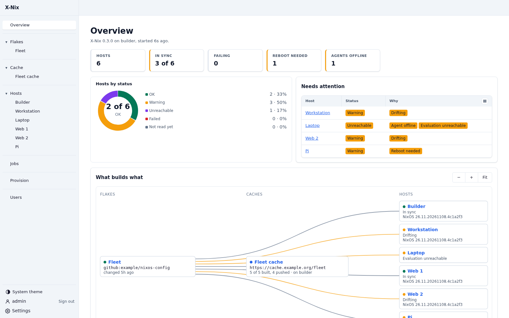
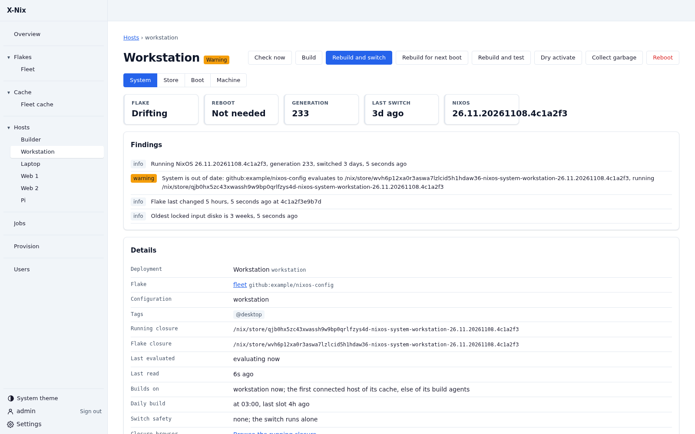
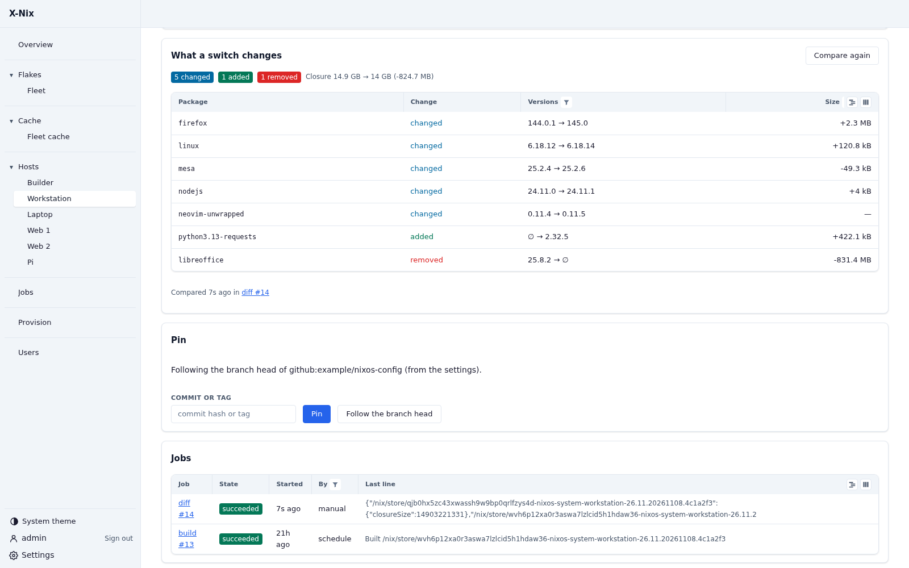
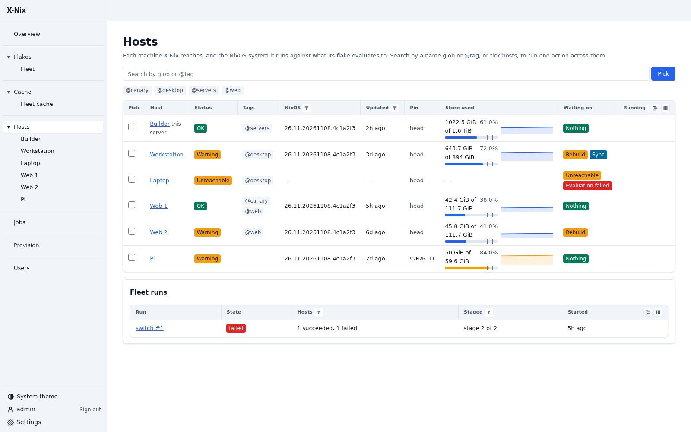
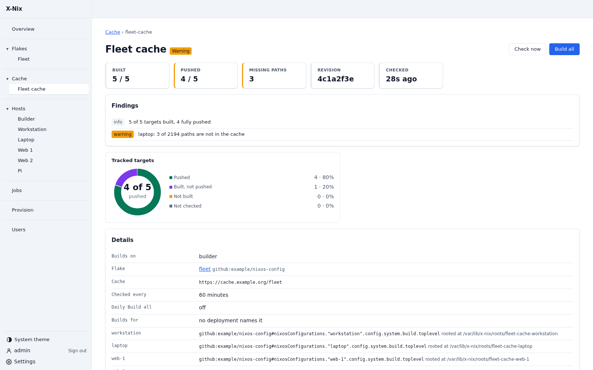
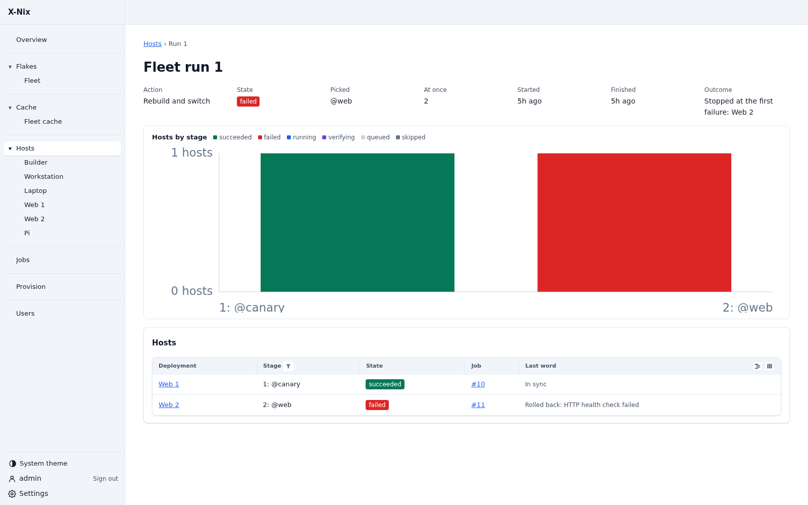
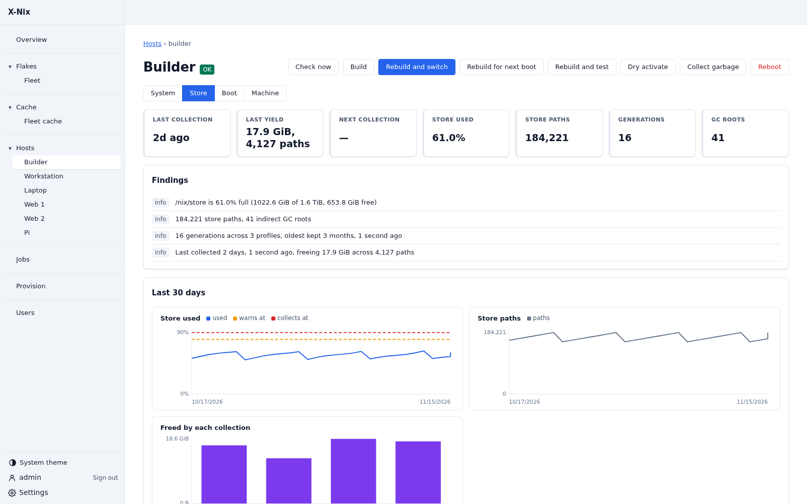

# X-Nix

<a href="https://liberapay.com/BeatLink/donate"></a> <a href="https://ko-fi.com/I4V52ANK6N"></a>

A web portal for managing NixOS deployments: drift against the flake, updates, builds, switches,
the Nix store, the Attic cache and boot entries.



**[Read the documentation](https://x-tech-laboratories.github.io/X-Nix/)**: the
[user guide](https://x-tech-laboratories.github.io/X-Nix/user/) for installing and using X-Nix, and the
[developer guide](https://x-tech-laboratories.github.io/X-Nix/developer/) for changing it. The same pages are in
[`docs/`](docs/).

## What it does

- **Drift at a glance.** Each machine's running system is compared with what its flake evaluates to.
- **Flakes kept fresh.** Inputs are watched and updated, committed and pushed, on a schedule or as soon as one moves.
- **Safer switches.** Checks before, health checks after, and a watchdog on the machine that rolls back a bad switch.
- **Build once.** A build machine fills an Attic cache, and small machines fetch their systems from it.
- **Fleet runs.** Build, switch or reboot many machines at once, or roll out in stages, canary first.
- **The machine too.** The Nix store and its garbage collection, boot entries, and Wake-on-LAN.
- **New machines.** Installs NixOS over SSH with nixos-anywhere, and builds installer media.
- **No open ports.** Each machine runs a small agent that dials out to the server.

| | |
| --- | --- |
|  |  |
|  |  |
|  |  |

## Installation

X-Nix is a flake with two NixOS modules: `nixosModules.default` runs the server on one machine, and
`nixosModules.agent` runs the agent on every other machine.

```nix
{
  inputs.x-nix.url = "github:x-tech-laboratories/X-Nix";

  outputs = { nixpkgs, x-nix, ... }: {
    nixosConfigurations.server = nixpkgs.lib.nixosSystem {
      modules = [ x-nix.nixosModules.default ./server.nix ];
    };
    nixosConfigurations.workstation = nixpkgs.lib.nixosSystem {
      modules = [ x-nix.nixosModules.agent ./workstation.nix ];
    };
  };
}
```

On the server, with the admins' password file from `npm run hash-password -- admin <file>`:

```nix
services.x-nix = {
  enable = true;
  passwordHashFile = config.sops.secrets.x_nix_password_hash.path;
  hosts.workstation.agent_key = "ssh-ed25519 AAAA... x-nix-agent-workstation";
  flakes.fleet.url = "github:example/nixos-config";
  deployments.server = { flake = "fleet"; configuration = "server"; };
  deployments.workstation = { host = "workstation"; flake = "fleet"; configuration = "workstation"; };
};
```

On every other machine, with a key made by `ssh-keygen -t ed25519 -N "" -C x-nix-agent-<host>`:

```nix
services.x-nix-agent = {
  enable = true;
  url = "wss://nix.example.org/api/agent";
  keyFile = config.sops.secrets.x_nix_agent_key.path;
};
```

The server listens on `127.0.0.1:7720`; put it behind a reverse proxy with HTTPS. The
[installation guide](https://x-tech-laboratories.github.io/X-Nix/user/installing/) covers every option, running without
the modules, and the sudo rules both services ship.

## Quick start

To run X-Nix from a checkout:

```sh
nix develop           # or nix-shell
npm install
npm run hash-password -- admin # adds a user to password.hash, which the dev server reads
npm run dev:server    # the API on http://127.0.0.1:7720, against config.example.json
npm run dev:web       # the page, reaching the API through Vite's proxy
```

Open the address `dev:web` prints and sign in as `admin`. `npm run build` type-checks and builds the page into `dist/`;
`npm start` serves both on one port. `npm test` runs the tests and `npm run lint` the linter. The
[development guide](https://x-tech-laboratories.github.io/X-Nix/developer/development/) has the rest.

## License

GPL-3.0-or-later.
