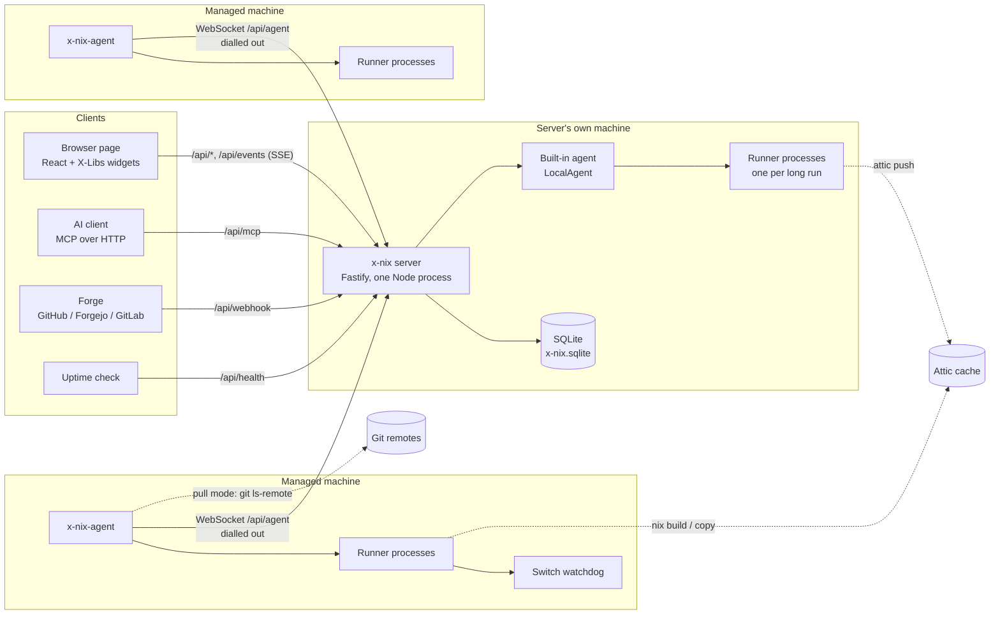
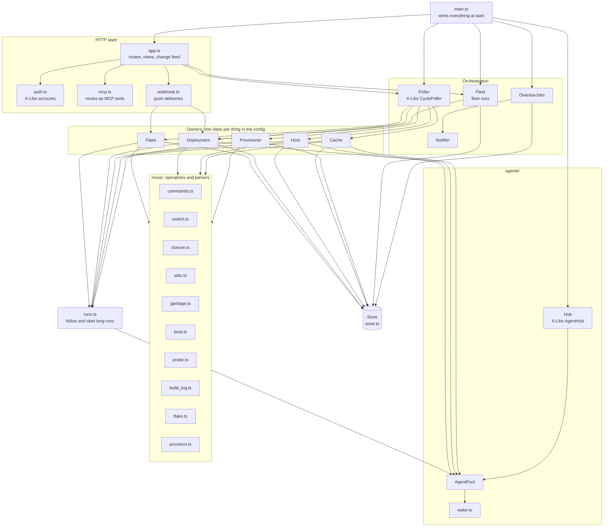

## The processes

X-Nix is one server process, one agent process on every other managed machine, and a runner process per long run.

| Process            | Runs as        | Lifetime                                   | Started by                       |
| ------------------ | -------------- | ------------------------------------------ | -------------------------------- |
| `x-nix` server     | `x-nix`        | The service.                               | systemd (`services.x-nix`).      |
| `x-nix-agent`      | `x-nix-agent`  | The service; redials whenever it drops.    | systemd (`services.x-nix-agent`). |
| Runner             | the agent's user | One long run; outlives the agent.        | The agent, in its own process group. |
| Watchdog           | the agent's user, rolling back with `sudo -n` | One guarded switch; outlives the run. | The switch, in its own session. |

The server's own machine runs an agent like any other, dialling in over `ws://127.0.0.1`, so the process that answers
the web runs nothing as root and its unit is sandboxed. With `X_NIX_LOCAL_AGENT=yes` (`localAgent`) the server holds a
`LocalAgent` from X-Libs for its own machine instead, which performs operations in the same way, so the code never has
to tell the two apart; `AgentPool.has_own_agent` says which it is.

`KillMode = "process"` in the module means a restart of either service stops only the main process; runners and
watchdogs carry on, and the server follows their output again from where it stopped.

## Design rules

These hold everywhere in the code; a change that breaks one needs a good reason.

1. **The config file is the source of truth for what exists.** Hosts, flakes, deployments and caches are never created
   or edited from the page. The database holds only what X-Nix *learned*: readings, evaluations, jobs, events, builds,
   samples, fleet runs, and agent keys it made. So there is no item history to keep (see the Application Standard's
   history rule).
2. **Agents run operations, not shell.** The server sends an `Operation`, plain data (see
   [Agent protocol](/developer/agent-protocol/)). The agent carries it out in TypeScript and runs only programs with
   argument vectors. The only `/bin/sh -c` runs commands a person wrote into the config.
3. **Anything slow is a long run.** Evaluations, builds, switches, updates, checks, installs: each runs in a runner
   process that writes to a folder, so it survives the server, the agent and the connection. The server reads its
   output by offset on each cycle.
4. **One cycle per thing, one timer per cycle.** Each host, flake, deployment and cache has a `cycle()` that the
   poller calls on its own timer; a running job shortens the interval to `job_poll`. Actions start a job and call
   `poller.soon()`; nothing waits on a job inside a request.
5. **The store is dumb.** `Store` knows tables, not rules. Each owner class (`Deployment`, `Host`, `Flake`, `Cache`)
   decides what its reading means and saves it whole as JSON.
6. **Reuse X-Libs first.** Accounts, sessions, tokens, the agent hub and client, long runs, polling, backups,
   notifications, webhooks, MCP and every widget come from X-Libs. A feature another app could use goes into X-Libs.

## Inside the server

### Start-up order

`main.ts` builds everything in this order, because later pieces need earlier ones:

1. Read settings from the environment (`read_server_config`) and the config file (`load_config`).
2. Take a staged restore if one waits beside the database, then open the `Store`.
3. Set up daily backups (`sqlite_backups`, `keep_backing_up`).
4. Make the `LocalAgent` and the `AgentPool`, give it the Wake-on-LAN settings, and make the hub that admits agents.
5. Make the `Provisioner` and give the hub the accepted agent keys: the config's, plus the ones X-Nix made.
6. Make a `Host`, `Cache`, `Deployment` and `Flake` for each config entry.
7. Make the `Poller` over all of them, the `Fleet`, `OverdueJobs` and the `Webhook`.
8. Build the Fastify app, listen, then start the poller, the fleet timer and the overdue watch.

### Owners

Each owner class wraps one config entry and is the only code that writes its state:

| Class         | Id in the store        | Cycle reads                             | Starts jobs of kind                         |
| ------------- | ---------------------- | --------------------------------------- | ------------------------------------------- |
| `Flake`       | the flake's id         | `nix flake metadata`, input remotes     | `update`                                    |
| `Deployment`  | the deployment's id    | the probe; the evaluation               | `eval`, `build`, `switch`, `boot`, `test`, `dry-activate`, `rollback`, `diff` |
| `Host`        | `host:<name>`          | the store probe, the boot probe         | `collect`, `reboot`, `next-boot`            |
| `Cache`       | the cache's id         | the cache check; the cache server's endpoints | `check`, `build-target`, `push`, `build-all` |
| `Provisioner` | `@provisioning` (its timer); jobs under the new host's name or the media's owner | its running jobs | `install`, `media` |

Flakes, deployments and caches share one id space, checked by `config.ts`, so their rows never collide; hosts are
prefixed with `host:` and the provisioner's timer with `@`.

## Statuses

Every reading carries a `Status` (`online`, `info`, `unavailable`, `warning`, `failed`), built as the worst of every
finding with `worse()` in `config.ts`. A change of status is written as an event by the owner, so the history shows
when something went wrong and when it recovered.

## The page

The page is a single-page React app in `src/web`, built by Vite into `dist/` and served by the server in production.
It uses the X-Libs `Shell`, router, accounts client and widgets, and Halon's styles; `app.css` holds layout only.
Each view loads what it shows from `/api` when it opens, and `follow_changes("/api/events")` reloads it whenever the
server announces a change. Routes are hash routes (`#/hosts/<name>/system`).
