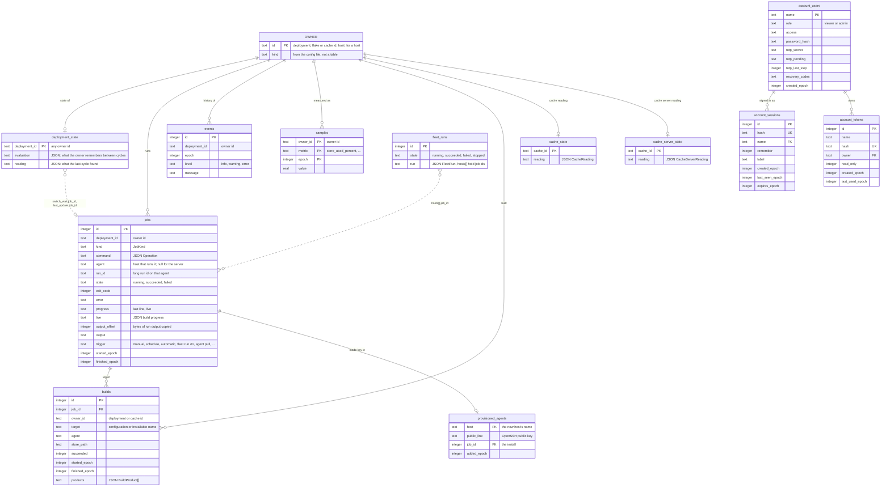

X-Nix keeps everything it learns in one SQLite file, `<X_NIX_STATE_DIR>/x-nix.sqlite`, opened by `Store`
(`src/server/store.ts`) through `node:sqlite` in WAL mode. The X-Libs accounts keep their tables in the same file,
through the same connection (`store.sql`).

What *exists* (hosts, flakes, deployments, caches) is never in the database: it comes from the config file at start.
Rows refer to those things by their config id, which is why the diagram below draws them as one conceptual entity.

## Entity-relationship diagram

No table declares a foreign key; every relation below is kept by the code. Dashed lines are relations through an id
held inside a JSON column.

## Tables

### `deployment_state`

Despite its name, this is the state of **every owner**: deployments (by id), flakes (by id), hosts (as
`host:<name>`) and caches (by id). Each row has two JSON columns, written whole by the owner class:

| Owner        | `evaluation` holds                                            | `reading` holds                     |
| ------------ | ------------------------------------------------------------- | ----------------------------------- |
| Deployment   | `Evaluation`: the target store path, eval and metadata errors, flake revision, the host that read it (`evaluated_on`) and ages, drift start, the auto-switch target, handled schedule slots, a pin override, the last package diff, a waiting switch (`switch_wait`), the revision it has run in sync with since when (`in_sync`), the revision its last switch failed at (`switch_failure`), and the target an automatic switch was last held for (`auto_switch_held`). | `Reading`: status, messages, running/booted system, generation, version, last switch, in sync, reboot required. |
| Host         | `HostState`: the last collection seen, the last daily collection slot. | `HostReading`: status, the store reading, the boot entries. |
| Flake        | `FlakeState`: the last update's outcome, the daily slot, the input heads already tried, the last input check error. | `FlakeReading`: status, messages, revision, ages, locked inputs, the host that read it. |
| Cache        | What the cache remembers between cycles, such as handled slots. | (unused; see `cache_state`)         |

`save_evaluation` and `save_reading` each upsert only their own column, so one never overwrites the other.

### `cache_state` and `cache_server_state`

A cache's last check (`CacheReading`: status, messages, revision, one `TargetRow` per target, the last Build all) and
what its server's own endpoints answered (`CacheServerReading`: info fields, health, size, byte metrics). The two have
separate statuses, so a down cache server never hides a target that is not built.

### `jobs`

One row per job, whoever owns it. A job holds its output up to `max_job_output_length` (16 MiB); `append_output` cuts the
middle of a longer one at whole lines, keeping the first `kept_output_head_length` and the last
`kept_output_tail_length` with `output_cut_line` between, so parsers that read the end still work. `output_offset` says
how many bytes of the run's output file are already copied in, so the next poll asks the agent for the rest; a cut never
changes it. `progress` is the last printed line,
for lists; `live` is the structured build progress (`BuildPlan` counts and tree). `command` is the operation as JSON,
which the job page shows.

Two indexes: `jobs_by_deployment (deployment_id, id)` for each owner's history, and a partial index on running jobs,
which every cycle asks for.

`JobKind` is one of `eval`, `update`, `build`, `switch`, `boot`, `test`, `dry-activate`, `rollback`, `diff`, `reboot`,
`collect`, `check`, `build-target`, `build-all`, `push`, `next-boot`, `install`, `media`. Evaluations and checks are
left out of job lists unless asked for, since they run every hour.

### `events`

The owner's history: status changes, refusals, rollbacks, automatic actions, overdue jobs.

### `builds`

One row per target a build job built or tried, with the Hydra build products read once when it ended. A product with
`size_bytes` set is a regular file inside the store path and may be downloaded. Index `builds_by_owner (owner_id,
target, id)`.

### `fleet_runs`

A whole `FleetRun` as JSON, beside its `state` so running ones are found without parsing. Each `FleetHost` inside holds
its deployment id, stage, state, `job_id` and timing.

### `samples`

Readings kept for charts, one per owner, metric and second, for 180 days (`sample_retention_in_seconds`); each insert
deletes that owner's older rows of the metric. Metrics: `store_used_percent`, `store_used_bytes`, `store_paths`,
`collection_freed_bytes` (hosts) and `cache_size_bytes` (caches).

### `provisioned_agents`

Agent keys X-Nix made during installs. `main.ts` passes them to the hub beside the config's own keys, which win for
the same host.

### Account tables

`account_users`, `account_sessions` and `account_tokens` belong to X-Libs' `AccountStore`. Admins declared in the
password file are not rows; they are merged in at start. Sessions and tokens store only hashes.

## Retention

`keep_pruning` in `src/server/retention.ts`, started by `main.ts`, runs `prune_history` a minute after the start and every
six hours, in one transaction, with the retention `X_NIX_HISTORY_RETENTION` (default `180d`, `never` turns it off).
Older than the retention it deletes finished fleet runs beyond the newest `kept_fleet_runs`, builds beyond the newest
`kept_per_kind` of each owner's target, finished jobs beyond the newest `kept_per_kind` of each owner's kind, and events
beyond each owner's newest `kept_events_per_owner`. It never deletes a running job, an `install` or `media` job, a job a
remaining build names, or a job any number under a key naming a job (`job_id`, `step_job_id`, `held_build`,
`stopped_jobs`) in a state, a reading, a cache reading, a remaining fleet run or a provisioned agent key points at
(`collect_job_ids`). Samples keep their own retention.

## Migrations

The schema is `CREATE TABLE IF NOT EXISTS`, run at every start. A new column is added in the `Store` constructor after
checking `PRAGMA table_info`, as `jobs.live` is. JSON documents grow by adding optional fields: code reading an older
document treats a missing field as absent (see `CacheReading.build_all`).

## Files beside the database

| Path under `X_NIX_STATE_DIR` | Holds                                                                 |
| ---------------------------- | --------------------------------------------------------------------- |
| `x-nix.sqlite` (+ `-wal`, `-shm`) | The database.                                                    |
| `backups/`                   | Daily and manual copies, `x-nix-<time>.sqlite`.                      |
| `backup-schedule.json`       | The backup schedule set on the Settings page.                        |
| `agent/`                     | With `localAgent`, the built-in agent's long runs, one folder each (`operation.json`, `out`, `exit`), and `switches/`. |
| `media/`                     | Garbage-collector roots of built install media.                       |

On every agent, `X_NIX_AGENT_STATE_DIR` holds its long-run folders, `pull.json`, the pull-mode switches not yet
reported, `pull.git`, where pull mode fetches a revision to check its signature, and `switches/`, where a guarded
switch's watchdog keeps its folder (`X_NIX_SWITCH_FOLDERS`); one an older agent left in `/tmp` is still found.
