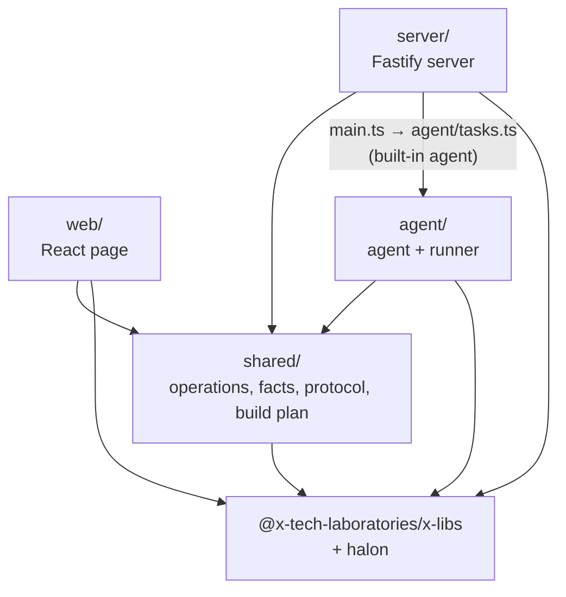
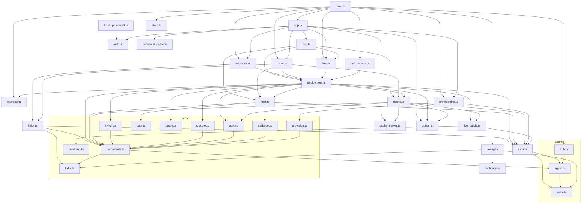
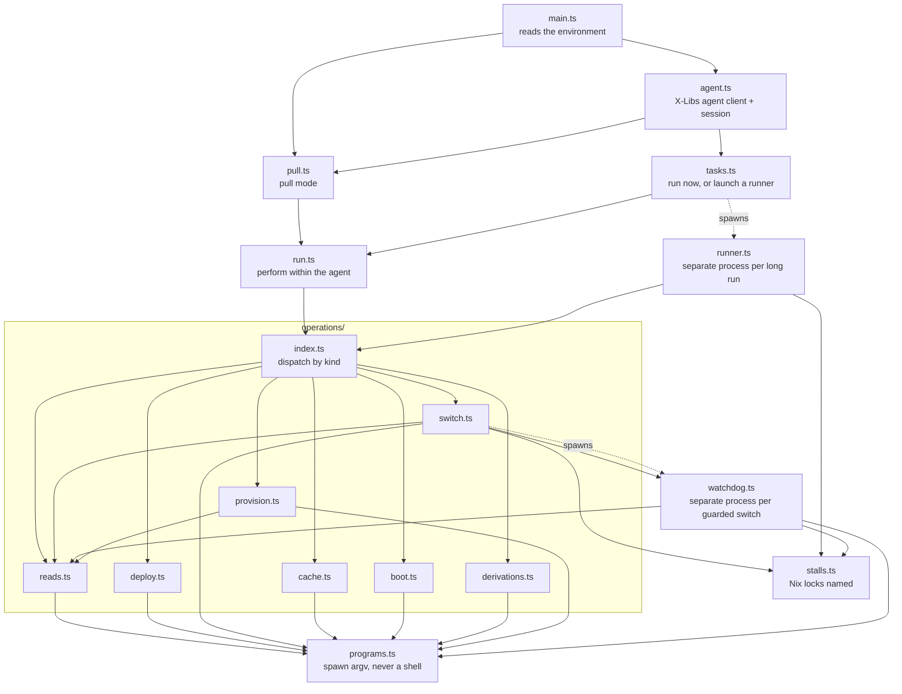
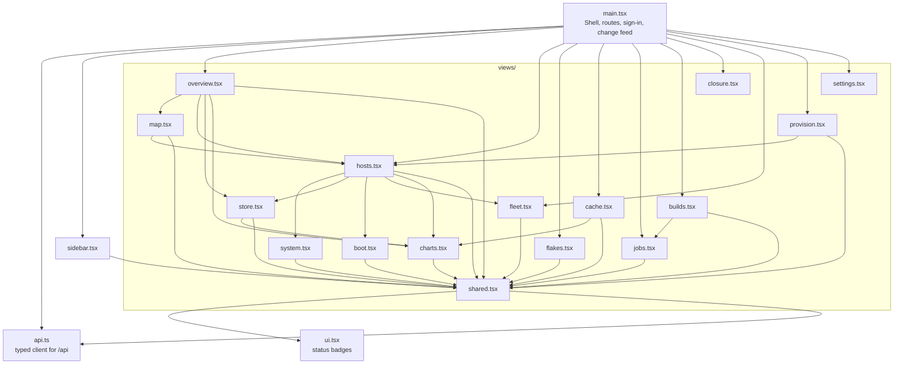

The source lives in four targets under `src/`, each with its own `tsconfig.<target>.json`:

```
src/
  server/   the Fastify server: routes, owners, polling, the store
    agents/   the agent pool, the hub, Wake-on-LAN
    nixos/    operations the server asks for, and parsers of what they print
  agent/    the agent and its runner, run on every managed machine and inside the server
    operations/  how each operation is carried out
  shared/   types and protocol used by more than one target
  web/      the React page
    views/    one file per page or tab
nix/        the package, the agent package, both NixOS modules, the sudo rules
tests/      one *.test.ts per behaviour, and fake_agent.ts, the scripted agent the tests drive
```

## Layers

Imports only point down this diagram. `shared` imports nothing of X-Nix's own; `web` never imports `server` or `agent`.
The one cross-target import is the server's `main.ts` taking `operation_runner` from `agent/tasks.ts`, so the built-in
agent performs operations exactly as a remote agent does.



## shared

| Module               | Holds                                                                                     |
| -------------------- | ----------------------------------------------------------------------------------------- |
| `operations.ts`      | Every `Operation` type, `innermost()`, output marker lines (`@@x-nix-eval`, `@@x-nix-switch`, `@@x-nix-cache`, `@@x-nix-diff`, `@@x-nix-stall`), watch folders. |
| `agent_protocol.ts`  | The `x_nix_app` description for X-Libs' agent protocol, and the `PullReport` shape.        |
| `facts.ts`           | What the reads answer: `ProbeFields`, `GcFields`, `Boot`, `Generation`, `BuildProduct`.    |
| `build_plan.ts`      | What a build plans to build and fetch, and the tree the job page draws.                    |

## server



`store.ts` and `config.ts` are imported by nearly every module; their edges are left out above to keep it readable.

| Module             | Role                                                                                       |
| ------------------ | ------------------------------------------------------------------------------------------ |
| `main.ts`          | Reads settings and the config, builds every object, starts the app and the timers.          |
| `app.ts`           | Every HTTP route, the view shapes the page reads, and the change feed.                      |
| `auth.ts`          | X-Libs accounts: declared admins from the password file, the `viewer` and `admin` roles, and which routes need which. |
| `canonical_paths.ts` | Refuses with 400 any request whose path is not spelled canonically, before sign-in or any route sees it. |
| `hash_password.ts` | The `npm run hash-password` command.                                                        |
| `mcp.ts`           | Exposes the routes as MCP tools through X-Libs' `api_spec` and MCP server.                  |
| `webhook.ts`       | The push webhook: checks the signature, debounces, evaluates, reads and updates.            |
| `config.ts`        | Parses and checks the config file into typed settings with defaults; `Status` and `worse()`. |
| `store.ts`         | The SQLite tables and every query; see [Data model](/developer/data-model/).                |
| `poller.ts`        | One timer per owner through X-Libs' `CyclePoller`; `refresh()` and `soon()`.               |
| `deployment.ts`    | Drift, evaluation, auto-switch, schedules, actions, the switch wait, diffs, generations, rollbacks. |
| `host.ts`          | The store and boot reads, Collect Garbage, Reboot, Set next boot.                           |
| `flake.ts`         | Metadata reads, input checks, Update.                                                       |
| `cache.ts`         | Checks, Build, Push, Build all, retry push, the cache server's status.                      |
| `cache_server.ts`  | Fetches and reads `nix-cache-info`, the health URL and Prometheus metrics.                  |
| `builds.ts`        | Records finished builds with their Hydra products; serves product downloads in pieces.      |
| `live_builds.ts`   | Turns a running build's structured log into live counts and the build tree.                 |
| `runs.ts`          | Starts a long run (waking and keeping awake when needed) and follows its output into a job. |
| `fleet.ts`         | Fleet runs: selection, parallelism, stages, sync verification.                              |
| `overdue.ts`       | Spots jobs running far past their usual time; warns and notifies once.                      |
| `provisioning.ts`  | nixos-anywhere installs, agent keys it made, install media.                                 |
| `pull_reports.ts`  | Takes an agent's pull-mode switches into the job history.                                   |
| `agents/agent.ts`  | The `Agent` interface and `AgentPool`: picking a host, waking it, waiting for it.          |
| `agents/hub.ts`    | X-Libs' `AgentHub` for X-Nix: admits agents by key, handles pull reports.                  |
| `agents/wake.ts`   | Magic packets and the keep-awake inhibitor wrapper.                                         |
| `nixos/commands.ts`| Builds the evaluate, build, update, input check, cache-holds and reboot operations.         |
| `nixos/switch.ts`  | Builds switch, confirm, rollback-signal, generations and rollback operations; reads a switch's verdict. |
| `nixos/closure.ts` | Diff and closure-graph operations and their parsers.                                        |
| `nixos/attic.ts`   | Cache check, build, push and Build all operations; parses the cache report into target rows. |
| `nixos/garbage.ts` | The store probe and collection operations; judges the store's status.                       |
| `nixos/boot.ts`    | Parses the boot probe; builds the one-shot next-boot operation.                             |
| `nixos/probe.ts`   | The cheap probe operation and its parser; works out whether a reboot is needed.             |
| `nixos/build_log.ts` | Parses nix's `--log-format internal-json` into log lines, counts and the plan.            |
| `nixos/flake.ts`   | Parses flake references (`github:`, `git+…`, paths), pins them, reads metadata JSON.        |
| `nixos/provision.ts` | The install and media operations.                                                         |

## agent



| Module                     | Role                                                                             |
| -------------------------- | -------------------------------------------------------------------------------- |
| `main.ts`                  | Reads `X_NIX_AGENT_*` and the pull file, starts the agent.                       |
| `agent.ts`                 | Dials the server, logs in with the host key, serves runs and long runs, sends pull reports. |
| `tasks.ts`                 | The `TaskRunner`: runs an operation now, or writes `operation.json` and launches a runner. |
| `run.ts`                   | Performs an operation in-process, collecting its output.                          |
| `runner.ts`                | The long-run process: reads the plan, writes `out`, notes stalls, writes `exit` atomically. |
| `programs.ts`              | Spawns one program with argv; optional `sudo -n`; echoes `$ argv` lines.         |
| `stalls.ts`                | X-Libs' `agent/stalls` with the Nix locks named and each note marked: after five quiet minutes, what still runs and which locks it waits on. |
| `watchdog.ts`              | Waits for activation and confirmation; rolls back and writes the outcome.        |
| `pull.ts`                  | Pull mode: watches Git remotes while the server is away, switches, keeps reports. |
| `operations/index.ts`      | `perform()`: dispatches on `kind`, unwrapping `kept_awake`, `timed` and `nix_config`. |
| `operations/reads.ts`      | probe, store probe, generations, products, locate, piece, remote heads.          |
| `operations/deploy.ts`     | evaluate, build, cache holds, closure diff, GitHub update.                       |
| `operations/switch.ts`     | The switch and its markers; confirm and rollback signals.                        |
| `operations/cache.ts`      | cache check, build, push, Build all.                                             |
| `operations/boot.ts`       | Reads systemd-boot, GRUB or EFI entries.                                         |
| `operations/derivations.ts`| Reads `.drv` files to learn which planned paths each derivation needs.           |
| `operations/provision.ts`  | nixos-anywhere installs and media builds.                                        |

## web



| View             | Route                               | Shows                                                    |
| ---------------- | ----------------------------------- | -------------------------------------------------------- |
| `overview.tsx`   | `#/`                                | Status donuts, needs attention, the flow map, job charts. |
| `map.tsx`        | inside the Overview                 | Flakes → caches → hosts, through X-Libs' `flow_map`.     |
| `hosts.tsx`      | `#/hosts`, `#/hosts/<name>/<tab>`   | The hosts table, fleet selection, one host's header and tabs. |
| `system.tsx`     | `#/hosts/<name>/system`             | Drift, details, the diff, pin, jobs, events, generations. |
| `store.tsx`      | `#/hosts/<name>/store`              | Store use, profiles, collections, charts.                |
| `boot.tsx`       | `#/hosts/<name>/boot`               | Loader, entries, Set next boot.                          |
| `closure.tsx`    | `#/hosts/<name>/closure`            | The closure browser.                                     |
| `fleet.tsx`      | `#/fleet/<id>`                      | One fleet run.                                           |
| `flakes.tsx`     | `#/flakes`, `#/flakes/<id>`         | Flakes and one flake.                                    |
| `cache.tsx`      | `#/cache`, `#/cache/<id>`           | Caches and one cache.                                    |
| `jobs.tsx`       | `#/jobs`, `#/jobs/<id>`             | The job list, one job with live output and build tree.   |
| `builds.tsx`     | `#/builds`                          | The build history and products.                          |
| `provision.tsx`  | `#/provision`                       | Installs, agent keys, media.                             |
| `settings.tsx`   | `#/settings` (and the old `#/users`) | Theme, about, MCP address, backups, users and tokens.    |
| X-Libs views     | `#/account`                         | `AccountView`; Users and Tokens are `users_settings` on Settings. |

## What comes from X-Libs

| X-Libs module                                   | Used for                                                            |
| ----------------------------------------------- | ------------------------------------------------------------------- |
| `server/config`                                 | Reading the server's settings from the environment.                 |
| `server/account_store`, `account_sign_in`, `passwords`, `hash_password` | Users, sessions, tokens, second factor, the password command. |
| `server/agents/hub`, `agents/local`, `agents/agent`, `agents/route` | The agent hub, the built-in agent, the WebSocket route.   |
| `agent/client`, `agent/session`, `agent/long_runs`, `agent/stalls`, `agent/tasks`, `agent/programs`, `agent/keys`, `agent/wake`, `agent/protocol` | The agent side of the protocol, long runs, key login, magic packets. |
| `server/runs`                                   | `follow_run`: copying a long run's output into a job.               |
| `server/poller`                                 | `CyclePoller`: one timer per watched thing.                         |
| `server/events`                                 | The `/api/events` change feed.                                      |
| `server/mcp`, `api_spec`                        | MCP tools from the routes.                                          |
| `server/forge_webhook`                          | Checking GitHub, Forgejo and GitLab signatures.                     |
| `server/notify/channels`                        | The `notifications` list: ntfy, webhook, mail and Apprise channels. |
| `backups`, `server/sqlite_backups`, `server/backup_routes` | Daily database backups and their routes.                 |
| `server/replies`, `server/web_folder`           | Error replies and serving the built page.                           |
| `durations`                                     | Parsing and formatting `30s`, `5m`, `2w`.                           |
| `web/*`, `web/react/*`                          | The shell, router, accounts client, tables, charts, dialogs, toasts, flow map, tree, badges, theme. |
